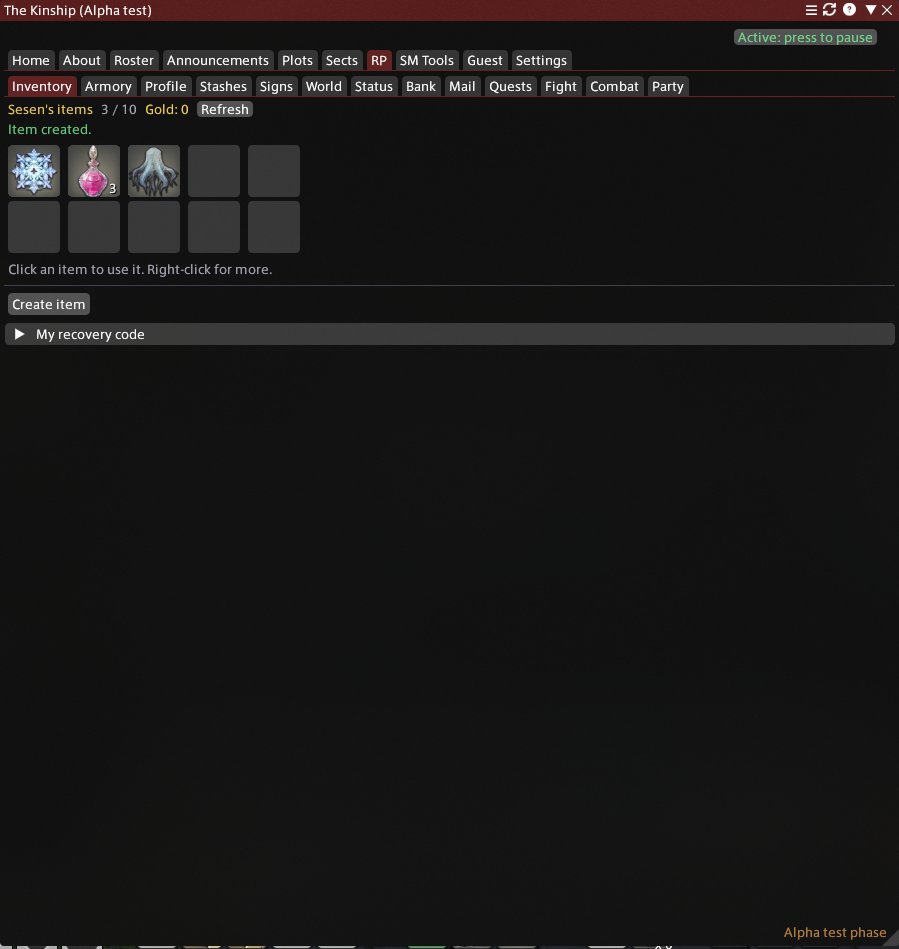
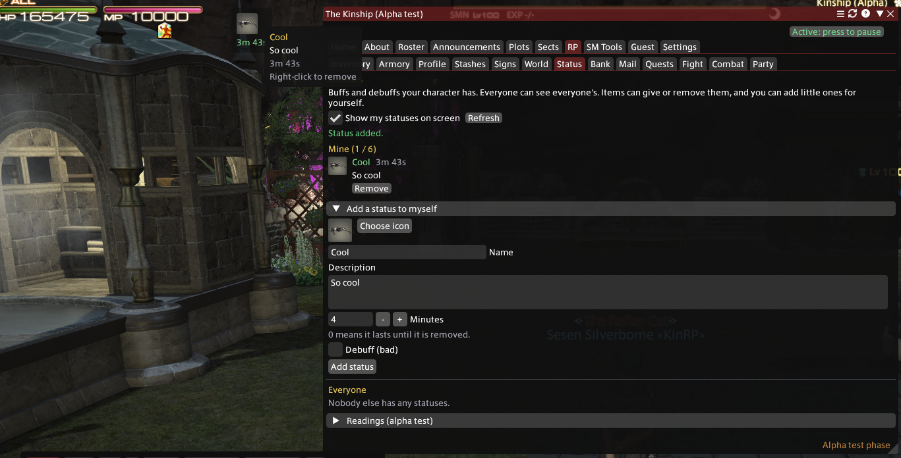
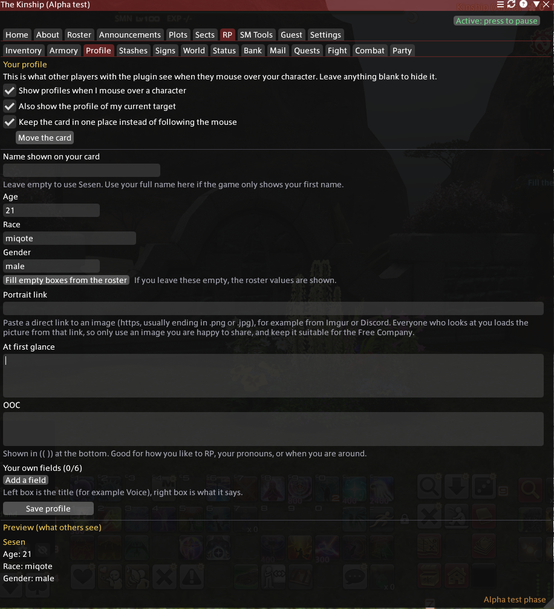

# The Kinship: in-game plugin
Companion plugin for The Kinship free company (Crystal / Mateus). Type `/kinship`.
Reads the same Google Sheet as the website. See INSTALL.md.

---
## A note from the author

I wanted to make sure I wrote something to anyone looking at my plugin.

**No AI writing, just me.** (Full disclosure: I have terrible spelling and grammar, so I did have AI check that.)

### Why I made it

This is my first plugin (and likely my last). I created it because I love RPing in game, and I wanted to bring back a heavy RP guild like I had years and years ago in WoW.

FFXIV lacked an all-in-one RP tool that had all the elements I wanted. Plugins had one or two features, but they weren't together, and some were too complicated to learn. With others, the dev stepped away and took the plugin servers down.

### How it started

I used AI to code this, and I used AI to design the websites. I didn't type in a generic "Make me an RP plugin" and just put up whatever Claude spit out.

First, I just wanted to transfer a site one of my kiddos made for me for keeping track of RP combat. It was an outside website that didn't touch the game. I wanted to move it to my Carrd site so I had access to edit it and didn't have to pester her.

I moved the website to a GitHub site... then I discovered I could make it an in-game plugin...

### How it grew

I started adding other features I missed from RP addons I've used in other MMORPGs, and from tools on FFXIV that are no longer in use. I also started adding my own wants and features that I felt would be very useful and beneficial to my FC.

I spent a lot of time sitting at my desk sketching out UIs, taking screenshots to fine-tune things, detailing features, troubleshooting issues, and testing features. It wasn't quick, but I've really enjoyed seeing this plugin come to life. I've been extremely excited and really, really proud of it.

### What it became

A simple dice roller on a website became something much, much more. It became a self-contained RP system.

I made this because I love to RP, and I wanted to offer those who join my FC an amazing level of interactive and immersive RP to go along with the game. There was no ill will, intent or malice behind any of this.

> So before you judge it for being made with AI, look at the code, look at the plugin, and look at what I was trying to create in the desire to just make the RP better.

---
What it looks like

### Everything here is a real screenshot from in game.

# Your own inventory
Items you create, with icons picked from the game's own icons. Click to use, right-click for more.

# World items
Leave an item out in the world for someone to find. When a player stands next to it, a small "You notice something" window offers a pick up.

# Statuses
Buffs and debuffs that show on screen, with an icon you pick yourself.

# Profile cards
What other players see when they mouse over your character.

# Combat
Run an RP encounter with turns, HP and loot, all inside the plugin.

# Quests
Story writers can build quests with steps, hints and rewards. NPCs only trigger them, and the plugin only reads game state.

---

## How this was made, and is it safe?

This plugin was made with the help of AI (Claude, by Anthropic). I have no coding skills: I designed the plugin, decided what every feature does, and directed the work in detail, and the AI wrote the code, helped find and fix bugs, and helped with the rest. I am  not a scammer or a botter, and made this only to make roleplay more fun and immersive for my FC and friends.

Left out on purpose: no automation (it never plays the game, presses keys or moves your character), no injecting into or changing the game (it only reads game information such as your position), no connections to other players' computers or services like Mare, Universalis or the social plugins, nothing downloaded or run on your PC, and no AI service inside the plugin.

It connects only to the Kinship server (the RP system), the Kinship website and Google Sheet, and to picture links that players put on their profiles. It sends your RP name and what you put into the RP system, your position when you use a feature that needs it (stashes, signs, world items, quests), and the name of a player you point at to show their profile card. It does not read your chat, game inventory, gil or account details. The code is public, so anyone can read it.
